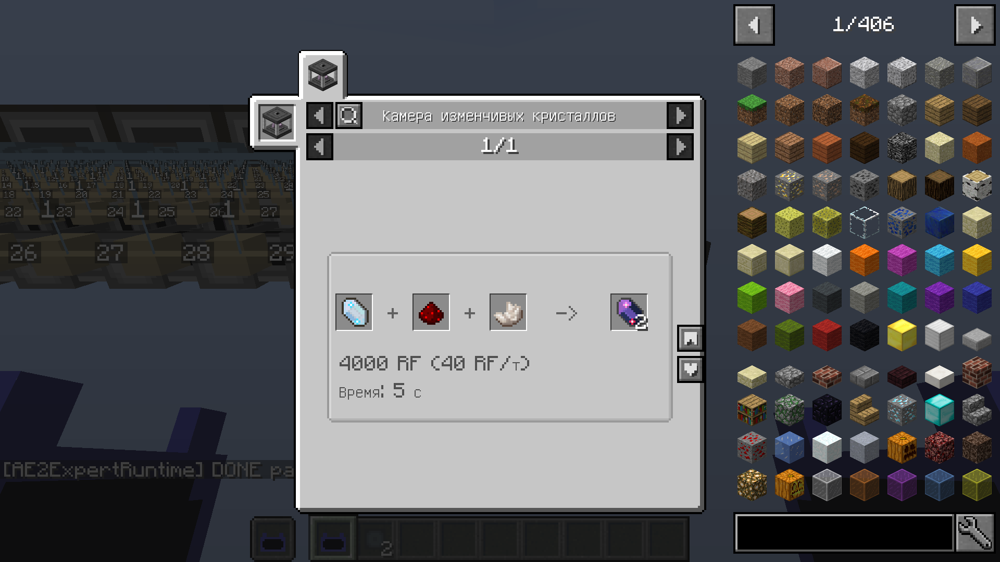
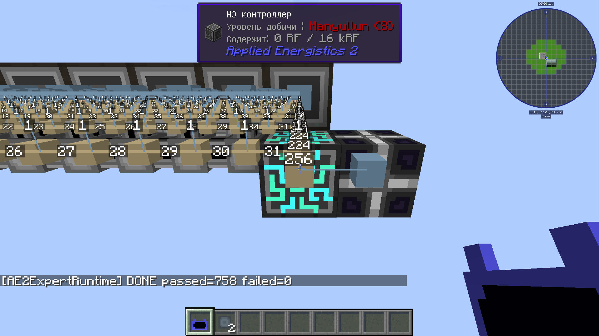

# AE2 Expert Addon

[English](README.md) | **Русский**

Аддон для **Enigmatica 2: Expert, Minecraft 1.12.2**. Версия **2.0.0**: 94 предмета и блока и 94 рецепта в прогрессии E2E. Неофициальное расширение Applied Energistics 2.

## Установка для игры

1. В разделе **Releases** скачайте `ae2expert-2.0.0.jar`.
2. Закройте Minecraft и сохраните резервную копию мира.
3. Через Prism Launcher откройте **папку Minecraft** нужного инстанса, затем `mods`.
4. Замените старый jar аддона новым. Одновременно оставляйте только одну версию.
5. На сервере и у всех клиентов установите одинаковую версию **2.0.0**.

Для игры не нужны исходники, JDK, Gradle, отдельный ресурспак или `runtime-checks.jar`. Зависимости уже входят в проверенную E2E; аддон не является самостоятельной сборкой модов. Подробности версий — [libs/README.md](libs/README.md).

## Возможности

| Модуль | Содержимое |
|---|---|
| Ячейки | По 16 тиров предметов, жидкостей и газов: 16k–512M байт, 63 типа; счётчики `long` |
| Особая ячейка | 1024 типа предметов, ёмкость `2^50` байт |
| Сборщики | ×2 / ×4 / ×8 / ×16 / ×32; штатная логика AE2, соответствующий расход энергии |
| Интерфейсы | 18 / 27 / 36 / 48 / 64 слота в каждой вкладке: настройка, буфер, шаблоны |
| Шины | Импорт и экспорт ×4 / ×8 / ×16; девять фильтров без карт ёмкости |
| Кабели | 32 / 64 / 128 / 256 каналов; для сети больше восьми каналов нужен контроллер |
| Камера кристаллов | Заряженный истинный кварц + редстоун + кварц Нижнего мира → 2 изменчивых кристалла за 100 тиков и 4000 RF |
| Конвертер | RF ↔ EU, переключение направления; базовый коэффициент 4 RF/EU, потери 10% в каждом направлении |
| Хранилища создания | 13 новых тиров: 128k, 256k, 512k, 1M, 2M, 4M, 8M, 16M, 32M, 64M, 128M, 256M и 512M. Продолжают штатную линейку 1k–64k. |
| Сопроцессоры создания | ×9, ×81 и ×729. Увеличивают число операций внутри одного задания AE2. |
| Стойка CPU создания | 18 слотов для штатных блоков и модулей аддона, по 64 одинаковых блока в слот. До 576 ГиБ памяти. Настройка через Shift + ПКМ. Пока CPU занят или возвращает предметы, слоты закрыты. |
| Беспроводная МЭ-сеть | Центр, четыре передатчика на 32, 64, 128 и 256 каналов и связыватель МЭ-сети. До 128 привязок и 256 каналов суммарно на центр. |
| Управление связями | Счётчик при наведении, имена, состояние и отдельный переключатель полупрозрачной линии для каждой связи. Можно видеть несколько линий одновременно. |

### Совместимость и надёжность

- Передатчики работают в одной МЭ-сети с центром. Оба конца должны быть загружены и находиться в одном измерении. Привязки и имена сохраняются, видимость линий каждый игрок выбирает на текущий сеанс.
- Плотные кабели поддерживают терминалы крафта, интерфейсы и шины. Подсказки и визуализатор AE2 Stuff показывают точное число каналов до 256. Цвет кабеля обозначает тир. У сборщиков сохранены прозрачный корпус и рабочая индикация, добавлены метки тиров.
- Фильтры жидкостных и газовых ячеек настраиваются в верстаке ячеек. Газовые ячейки используют ExtraCells и Mekanism. Повреждённые записи сохраняются в NBT, а подсказка предупреждает о проблеме. Рецепты улучшения такие ячейки не принимают.
- МЭ-интерфейс хранит остатки пополнения запасов отдельно от ингредиентов обработки. Очередь сохраняется при перезагрузке. Ускоренные сборщики сохраняют задания в очереди, а результат камеры кристаллов можно забирать автоматизацией.
- Shift + ПКМ открывает стойку с пустой рукой и с предметом. Carry On не может поднять стойку. Обычный ПКМ по активному блоку открывает экран задания AE2.
- Рецепты вписаны в прогрессию E2E. В JEI/HEI рецепт камеры показан рядом со штатным броском в воду. Названия, подсказки и меню доступны на русском и английском.

Газовые ячейки используют ExtraCells и Mekanism. Конвертер поддерживает Forge Energy, классический RF и IC2 EnergyNet; до 256 EU преобразования за тик.

## Что изменилось в 2.0.0

Хранилища создания от 128k до 512 МиБ, сопроцессоры ×9 / ×81 / ×729 и стойка на 18 слотов по 64 модуля. Нажмите Shift + ПКМ для настройки стойки. Сопроцессоры увеличивают число операций внутри одного задания. Отдельные одновременные задания требуют отдельных CPU.

[Изменения](CHANGELOG-2.0.0.md) · [Архитектура](docs/CRAFTING-CPU-DESIGN.md) · [Проверка](docs/VALIDATION-2.0.0.md)

## Беспроводные связи

Один центр поддерживает до 128 передатчиков на 32, 64, 128 или 256 каналов. Передатчики привязываются связывателем. Меню центра показывает имена и состояние связей и позволяет включить несколько полупрозрачных линий. [Инструкция](docs/WIRELESS-LINKS.md).

## Использование и ограничения

Интерфейс открывается ПКМ. Во вкладке настройки ЛКМ копирует тип и количество из руки, ПКМ задаёт один предмет. Пустая рука очищает слот ЛКМ или уменьшает количество ПКМ. Образцы не расходуют предметы. Интерфейс поддерживает заданный запас в соответствующих слотах буфера и возвращает излишки в МЭ. Внешние трубы работают с буфером.

Шаблоны верстака передаются соседнему молекулярному сборщику, обработки — соседнему инвентарю. Непереданный остаток сохраняется в NBT и повторно отправляется тому же соседу. Интерфейс требует один канал.

У новых интерфейсов собственный GUI. Терминал интерфейсов AE2, приоритеты, блокирующий режим, карта автоматического заказа запасов и сквозной доступ к жидкостной сети для этих блоков пока не реализованы.

Конвертер меняет направление кнопкой GUI или Shift+ПКМ. В режиме RF→EU RF доступен на вход, в режиме EU→RF — на выход. Буферы сохраняются при выгрузке чанка.

Цвет кабеля обозначает тир, а не изолированную цветовую сеть. Штатная перекраска отключена. Полосы показывают долю занятой ёмкости; подсказки и визуализатор передают точные числа до 256. Пропускная способность обычных кабелей AE2 и P2P сохраняется; на плотных кабелях разрешены части.

Крафт улучшения ячеек требует пустых исходных ячеек со снятыми картами. Ячейки не вкладываются в ячейки аддона. Высокие тиры используют корпуса ExtraCells и иридиевые пластины E2E.

## Для разработчиков

- [Сборка из исходников](docs/BUILDING-RU.md): JDK 8, Python 3.9+, Gradle Wrapper 4.10.3, ForgeGradle 2.3.10.
- [Проверенные зависимости](libs/README.md).
- Для сообщений об ошибках используйте вкладку **Issues** репозитория: приложите версии модов, действия для повторения и относящуюся к ошибке часть журнала. Перед отправкой удалите личные сведения.

Исходники находятся в `src/main`, проверки — в `src/test`, генераторы моделей/рецептов и инструменты — в `tools`. Основной jar не содержит проверочный мод. Компиляция выполняется против Forge 2847; фактический игровой прогон проведён в E2E с Cleanroom 0.6.11-alpha (Forge-совместимость 2864), Java 25 и Nothirium. Это не заменяет длительное тестирование всех возможных сборок.

## Лицензии

**Код: LGPL-3.0-only** ([LICENSE](LICENSE)). **Производные текстуры и модели AE2: CC BY-NC-SA 3.0**; их нельзя считать материалами под LGPL. Авторы исходных материалов AE2 — AlgorithmX2 et al. Подробное авторство, изменения и тексты лицензий: [NOTICE-RU.md](NOTICE-RU.md), [licenses/](licenses/).
