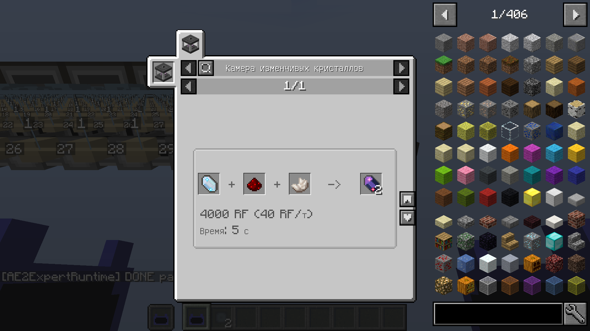
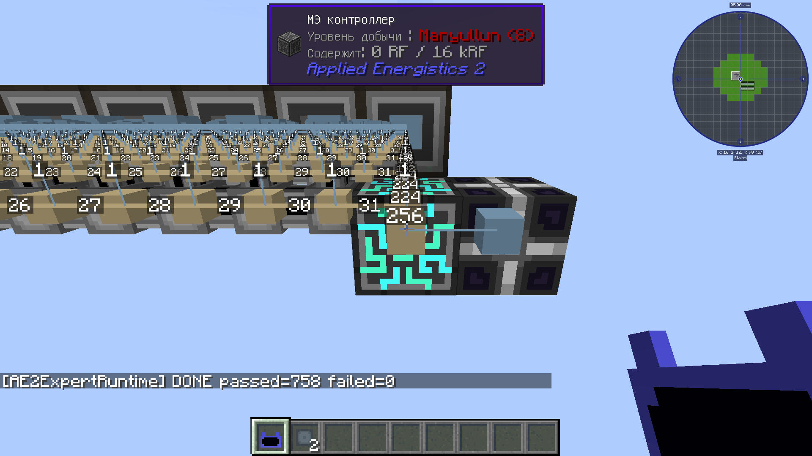

# AE2 Expert Addon

**English** | [Русский](README-RU.md)

An unofficial Applied Energistics 2 expansion for **Enigmatica 2: Expert 1.93a**, Minecraft **1.12.2**. Version **2.0.0** adds 94 items and blocks, with 94 crafting recipes designed for E2E progression. In-game language: **English and Russian**, selected through Minecraft's language settings.

## Installation

1. Download `ae2expert-2.0.0.jar` from **Releases**.
2. Close Minecraft and back up your world.
3. Open your instance's Minecraft folder in Prism Launcher, then open `mods`.
4. Replace the previous addon jar. Keep only one version installed.
5. Install version **2.0.0** on the server and every client.

Players do not need the source archive, JDK, Gradle, a separate resource pack, or `runtime-checks.jar`. The required mods are already part of the tested E2E setup. See [dependencies](libs/README.md) for exact versions.

## Features

| Module | Contents |
|---|---|
| Storage cells | 16 tiers each for items, fluids and gases: 16k–512M bytes, 63 types, long counters |
| Infinite storage cell | 1024 item types and 2^50 bytes; extremely large but finite capacity |
| Molecular assemblers | ×2 / ×4 / ×8 / ×16 / ×32; AE2 crafting logic with corresponding energy use |
| ME interfaces | 18 / 27 / 36 / 48 / 64 slots per configuration, stock and pattern tab |
| Import/export buses | ×4 / ×8 / ×16; nine filters available without capacity cards; AE2 upgrade support |
| Cables | 32 / 64 / 128 / 256 channels; networks above eight channels need a controller |
| Fluix Crystal Chamber | Charged Certus Quartz + Redstone + Nether Quartz → 2 Fluix Crystals in 100 ticks, using 4000 RF; JEI/HEI recipe integration |
| RF ↔ EU Converter | Switchable direction, base rate 4 RF/EU, 10% loss in each direction |
| Crafting storage | 13 new tiers: 128k, 256k, 512k, 1M, 2M, 4M, 8M, 16M, 32M, 64M, 128M, 256M and 512M. Extends the stock 1k–64k line. |
| Crafting coprocessors | ×9, ×81 and ×729. They increase the operation budget within one AE2 crafting job. |
| Crafting CPU Rack | 18 slots for stock or addon storage blocks and coprocessors, up to 64 matching blocks per slot and 576 GiB of memory. Sneak-right-click to configure. Editing is locked while the CPU is busy or returning items. |
| Wireless ME network | One hub, four relays (32, 64, 128 and 256 channels) and an ME Network Linker. Up to 128 pairings and 256 channels in total per hub. |
| Wireless management | Connection count on hover, named links, online status and individually selectable translucent lines. Several lines can be visible at once. |

### Integration and reliability

- Wireless links use the same AE2 network as the hub. Both ends must be loaded in the same dimension. Pairings and names persist. Line visibility is local to each player for the current session.
- Dense cables accept crafting terminals, interfaces and buses. Tooltips and the AE2 Stuff visualizer report full counts up to 256. Cable colors identify tiers. Assemblers retain their transparent casings and activity effects, with tier markings.
- Fluid and gas cell filters work in the Cell Workbench. Gas cells use ExtraCells and Mekanism. Damaged storage records are retained in NBT and flagged in the tooltip so a cell upgrade cannot discard them.
- Processing ingredients and stock recovery are kept separate in ME interfaces. Pending items survive reloads. Accelerated assembler queues preserve pending work, and the Fluix Crystal Chamber output supports automated extraction.
- The rack opens on Shift + right-click with either an empty hand or an item. Carry On is blocked from picking it up. Active racks still offer the normal AE2 job screen on right-click.
- Recipes follow E2E progression. JEI/HEI includes the chamber recipe alongside the water method. Names, tooltips and menus are available in English and Russian.

Gas cells use ExtraCells and Mekanism. The converter supports Forge Energy, classic RF and IC2 EnergyNet, with up to 256 EU of conversion input per tick.

## Version 2.0.0

Crafting storage from 128k to 512 MiB, ×9 / ×81 / ×729 coprocessors, and a rack with 18 slots of up to 64 modules each. Sneak and right-click the rack to edit its modules. Coprocessors raise the operation budget of one job. Concurrent independent orders require separate CPUs.

[Changelog](CHANGELOG-2.0.0.md) · [Design](docs/CRAFTING-CPU-DESIGN.md) · [Validation](docs/VALIDATION-2.0.0.md)

## Wireless links

One hub supports up to 128 remote relays with 32, 64, 128 or 256 channels per relay. A linker pairs relays with the hub. The hub UI shows and renames pairings and toggles several translucent connection lines. [Wireless link guide](docs/WIRELESS-LINKS.md).

## Usage and limitations

Right-click an interface to open it. On the configuration tab, left-click copies the held item and stack size; right-click sets one item. With an empty cursor, left-click clears a sample and right-click reduces it. Samples do not consume items. The interface maintains the requested stock in matching buffer slots and returns excess items to ME storage. External pipes access the buffer only.

Crafting patterns go to an adjacent molecular assembler; processing patterns go to an adjacent inventory. Undelivered ingredients are saved and retried at the same neighbor. Stock-recovery items are saved separately. Hover over the network indicator to see how many items await delivery. Each interface needs one channel.

The new interface blocks have their own GUI. Integration with AE2's Interface Terminal, priorities, blocking mode, the crafting card for stocking, and fluid-network pass-through are not implemented for these blocks.

Use the converter's GUI button or sneak-right-click to switch direction. RF is accepted in RF→EU mode and extracted in EU→RF mode. Buffers survive chunk unloads; sub-RF energy remains in the EU buffer.

Cable color identifies the tier, rather than an isolated AE2 color network. Standard recoloring is disabled. Indicators show the proportion of capacity in use; tooltips and the visualizer show exact counts up to 256. Dense cables accept terminals, interfaces and buses. Native channel capacity and P2P behavior are preserved.

Cell upgrades require empty input cells with upgrade cards removed. Damaged entries are preserved separately in NBT and flagged in the tooltip; affected cells cannot be upgraded through crafting. Addon cells reject direct insertion of storage cells. Higher tiers use ExtraCells housings and E2E iridium plates.

## Development and support

- [Build from source](docs/BUILDING.md)
- [Dependency versions](libs/README.md)
- Report reproducible problems through **Issues**, including versions, reproduction steps and relevant logs with private data removed.

Source code is in `src/main`, checks in `src/test`, and tools in `tools`. The main jar excludes the test mod. Compilation targets Forge 2847 because ForgeGradle 2.3 needs the older userdev artifact. The gameplay tests used E2E with Cleanroom 0.6.11-alpha (Forge compatibility 2864), Java 25 and Nothirium. See the audit for test coverage and limits.

## Licensing

Code: **LGPL-3.0-only** ([LICENSE](LICENSE)). AE2-derived textures and models: **CC BY-NC-SA 3.0**, separately from the code license. Original AE2 assets are by AlgorithmX2 et al. See [NOTICE.md](NOTICE.md) and [licenses](licenses/). This is not an official AE2 or Enigmatica release.
