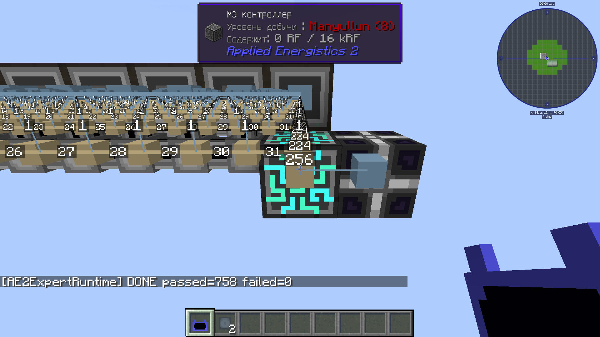
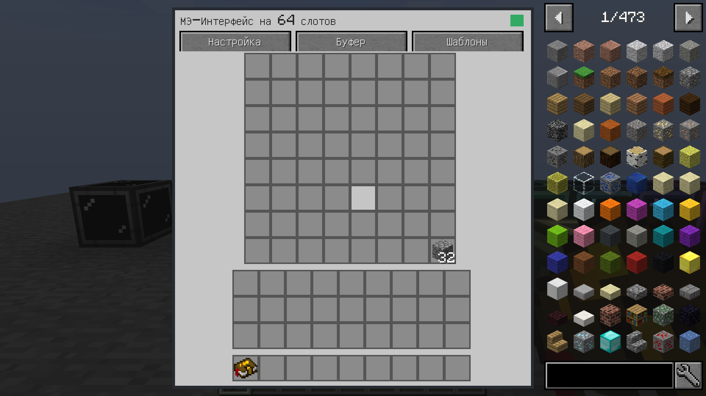

# Проверка версии 1.1.0

Проверки выполнялись 14 ноября 2026 года в отдельном локальном профиле. Пользовательские миры не использовались.

## Регрессии и ресурсы

- 103 регрессионные проверки: длинные счётчики и сохранение, ограничения типов, симуляция ввода/вывода, энергетические буферы, преобразованный байткод AE2, шкалы кабелей и сериализация визуализатора AE2 Stuff на границах 127/128/255/256.
- 191 JSON, 71 рецепт, по 97 ключей в русской и английской локализациях.
- Основной jar имеет манифест coremod и байткод Java 8; проверочные классы в него не входят.

## Игровой стенд

Среда: E2E, AE2 rv6-stable-7, ExtraCells 2.6.7, Cleanroom 0.6.11-alpha (Forge-совместимость 2864), Java 25, Nothirium. Сборка выполнена JDK 8, Gradle 4.10.3, ForgeGradle 2.3.10, Forge 2847.

Финальный результат: **758 проверок, 0 ошибок**. Проверены регистрация предметов и рецептов, большие ячейки и NBT, газовый канал, карты ячеек, установка шин/кабелей, крафт кристаллов и расход RF, направление конвертера, запас в 64-м слоте интерфейса, публикация шаблона из 18-го слота, реальный крафт сборщика и передача обработки во внешний сундук.

Реальные сети: **32/32, 64/64, 128/128, 256/256** активных интерфейсов. Проверены NBT, клиентский пакет и настоящий провайдер Waila: «32 из 32», «64 из 64», «128 из 128», «256 из 256». Визуализатор AE2 Stuff прошёл построение графа и передачу данных сервер→клиент; на снимке ниже видна подпись 256.

Дополнительно: **8192 построения настоящих моделей кабелей AE2 в четырёх потоках**, без исключений и пустой геометрии. Проверено применение приглушённой палитры и отсутствие изменения исходных граней кэша. В заключительном прогоне не было сообщения CCL об ошибке рендера или ConcurrentModificationException.

GUI интерфейса на 64 слота также проверялся при масштабе 4:

## Пределы проверки

Не выполнялся длительный прогон выделенного сервера со всеми возможными сторонними механизмами и конфигурациями. Отдельная Linux/macOS-сборка не проверялась. The One Probe проверен на уровне преобразования байткода; в игровом стенде использовался Waila. Новая упаковка релиза добавляет лицензии и корректирует метаданные Minecraft; игровые классы и визуальные ассеты не изменяются.

Полные локальные журналы содержат пути компьютера и не включены в публичный пакет. Регрессионный и игровой стенды входят в исходники для воспроизведения проверок.
