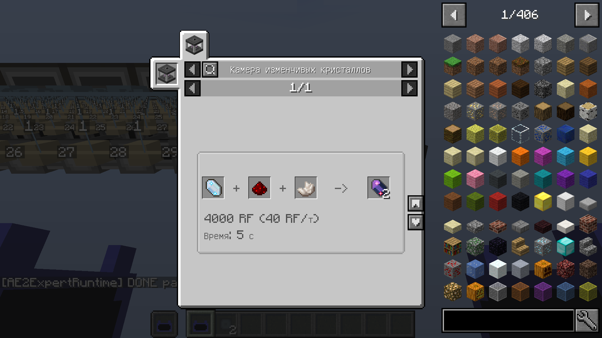

# Проверка версии 1.2.0

Дата: 14 ноября 2026 года, Москва. Проверки выполнялись в отдельном профиле, без открытия пользовательских миров.

## Сборка и регрессии

JDK 8u512, Gradle Wrapper 4.10.3, ForgeGradle 2.3.10, компиляция против Forge 2847. Прошли **105 регрессионных проверок**. Статическая проверка: 191 JSON, 71 рецепт, по 100 ключей локализаций RU/EN.

Основной jar включает лицензии, NOTICE и манифест coremod. Проверочный мод в основной jar не входит.

## Новые игровые сценарии

**657 проверок, 0 ошибок** (648 серверных и 9 проверок индексов/категории HEI):

- По 19 частей на каждом из четырёх кабелей аддона и двух обычных плотных кабелей AE2: **114 частей**. Проверены обычный, крафтовый, шаблонный и интерфейсный терминалы; предметные/жидкостные интерфейсы; шины импорта, экспорта, хранения и все шесть шин аддона.
- Установка в двух порядках: терминал до кабеля и часть после кабеля.
- **36 блочных интерфейсов** (все пять тиров аддона и обычный AE2 на каждом кабеле) получают рабочий канал.
- На всех 36 шинах аддона отсутствуют карты ёмкости и обе группы дополнительных слотов открыты. Ванильные шины сохраняют блокировку без карты.
- **18 импортов и 18 экспортов** реально передают предметы по девятому фильтру. Остальные восемь фильтров настроены на другой предмет. Независимые контейнеры стенда не объединяются, как соседние сундуки.
- Для 114 кабельных блоков с частями явно запрошены коллизии. Исправление INTERNAL предотвращает NullPointerException в PartDenseCable.isDense при контакте выпавших предметов с плотным кабелем.
- HEI обнаружил плагин, категорию, рецепт и станок-катализатор. Камера находится по R на изменчивом кристалле и по U на каждом из трёх ингредиентов. Среди способов получения сохраняется исходная категория `jetif` («Бросок в воду»).

## Сохранённые сценарии

Прошли **758 прежних игровых проверок**: ячейки и NBT, рецепты, реальные сети 32/64/128/256, телеметрия Waila и клиентских пакетов, камера кристаллов и расход RF, конвертер, интерфейсы, шаблоны крафта/обработки и сборщики.

**8192 построения моделей кабелей в четырёх потоках**, без ошибок и пустой геометрии. Проверены приглушённая палитра и сохранность исходных граней общего кэша.

В заключительном прогоне не было вылета сервера, сообщения CCL об ошибке рендера или ConcurrentModificationException. До исправления отдельный прогон выявил вылет AE2 на внутреннем соединении плотного кабеля; этот сценарий добавлен в проверки.

## Среда и пределы проверки

E2E с AE2 rv6-stable-7, ExtraCells 2.6.7, HEI 4.35.0, Cleanroom 0.6.11-alpha (Forge-совместимость 2864), Java 25 и Nothirium. Обычный JEI 4 использует тот же API, но отдельный игровой прогон на нём не выполнялся. The One Probe проверялся на уровне ASM; в игре использовался Waila. Длительный прогон выделенного сервера со всеми сторонними механизмами не выполнялся.

Полные локальные журналы содержат пути компьютера и не включены в публичный архив. В исходники входят регрессионный и игровой стенды.
